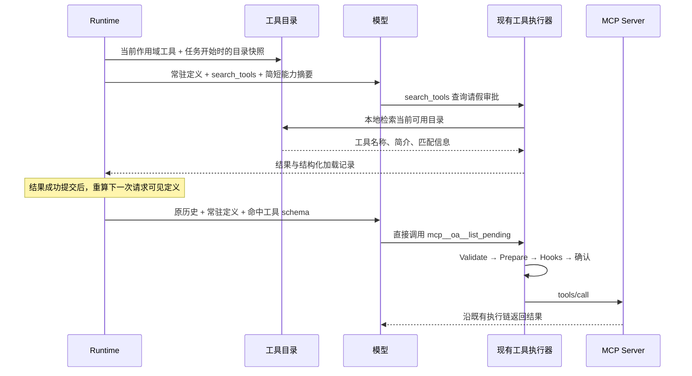

# 工具发现与按需加载设计

状态：首版实现，默认关闭。2026-10-30。

基于 `d048b006` 的实现包含 SDK、运行主机 API、原生桌面与 Web 设置。本文记录实现边界与取舍；配置见 [CONFIG](../CONFIG.md)，HTTP 契约见 [API](../API.md)。

## 1. 首版决策

在宿主维护完整工具目录，模型先获得常驻工具，需要额外能力时调用 `search_tools`。成功搜索选中的工具从下一次模型请求起进入 `tools`，随后按原名称直接调用，复用现有执行器。

- 支持普通 OpenAI-compatible、Anthropic 工具调用；首版使用本地检索，不依赖供应商原生 Tool Search。
- 两种模式：`off` 完整加载、`local` 按需加载。默认 `off`，既有用户和 SDK 调用者保持原行为。
- 常用内置工具常驻；MCP 与明确标记的部分扩展工具可以延迟提供定义。
- Skills 继续采用“简介与路径进入上下文、正文按需读取”。工具搜索不搜索技能市场，也不替代技能目录。
- 搜索只读，不启动、连接、安装或调用业务工具；沿用 MCP 当前的后台连接和活动任务租约。
- 同时治理系统提示与请求 `tools`，上下文统计使用真正发送的请求。
- 搜索后直接调用原工具，首版不引入通用执行包装器。工具列表变化对缓存的影响纳入成本验证。

## 2. 改造前行为与实现落点

| 改造前行为 | 入口 | 实现 |
|---|---|---|
| 全部已注册工具转成模型定义 | [agent.go](../../sdk/agent/agent.go)，`toolDefinitions` / `llmRequest` | 执行注册表与模型可见定义分开 |
| 系统提示再次展开全部工具描述与参数 | [coding/prompt/builder.go](../../internal/agents/coding/prompt/builder.go)，`Available Tools` | local 下删除延迟工具的完整展开，不能只改 API 的 tools |
| 每个用户任务开始前检查工具版本并重建 Agent | [agent_session.go](../../sdk/runtime/agent_session.go)，`preparePrompt` / `refreshToolsLocked` | 在这个边界固定目录与加载策略 |
| MCP 已过滤服务状态、include/exclude，并支持列表刷新 | [manager.go](../../sdk/mcp/manager.go)，`AllTools` / `RefreshTools` | 复用连接和版本更新，不建立另一套 MCP Client |
| 原始工具对象负责参数准备、确认及执行 | [tool.go](../../sdk/agent/tool.go)、[loop.go](../../sdk/agent/loop.go) | 发现层只选定义，执行仍找到原对象 |
| Skills 输出名称、描述、文件路径，并提示读取正文 | [skill.go](../../sdk/skill/skill.go)，`FormatForSystemPrompt` | 保留现有机制；EasyAgent 没有必要照搬独立 Skill 工具 |
| JSONL 保存结果 Details，按分支和压缩记录恢复上下文 | [types.go](../../sdk/ai/types.go)、[session.go](../../sdk/session/session.go) | 用已提交历史恢复已加载集合，避免第二份状态文件 |

首版实施只涉及这条能力链。会话内容搜索、长期记忆、知识库建设、MCP 协议版本切换不属于本设计。

## 3. 工具分层

以下分类只对已启用、属于当前工作区且通过现有工具过滤的工具生效。按需加载不使被禁用的工具重新出现。

| 类别 | 首版策略 | 说明 |
|---|---|---|
| `read`、`write`、`edit`、`patch`、`grep`、`find`、`ls` | 常驻 | 基础文件操作不额外增加搜索轮次 |
| `bash`、`bash_output`、`bash_kill` | 启用时常驻 | 保留执行、观察与停止后台任务的完整操作链 |
| `ask_user_question`、`todo_write`、`task`、`full_output` | 当前作用域允许时常驻 | 交互、规划、委派及大结果取回入口保持可见 |
| `save_memory`、`delete_file`、`local_time` | 首版常驻 | 先保持现有内置行为，不为很短的定义增加搜索成本 |
| `web_search`、`web_fetch`、`computer`、`skill_market` | local 下延迟 | 显式逐项标记，工具名称和简短用途进入能力摘要 |
| MCP 工具 | local 下默认延迟 | 可通过所属服务的 `alwaysLoad` 强制常驻 |
| 未声明加载策略的自定义工具 / 其他 Application 工具 | 常驻 | 可选接口逐步接入，不通过名字猜测是否延迟 |
| 已安装 Skills | 元信息先提供，正文按需读取 | `skill_market` 是市场操作工具，不是已安装技能目录 |

分类是 EasyAgent 的产品策略，可以根据任务数据调整。工具来自 MCP 或内置实现，都不能代替对实际使用频率、定义体积和操作依赖的判断。

## 4. 用户界面与配置

### 设置入口

在 **设置 → 模型连接 → 工具加载** 增加一个紧凑设置行，放在主机默认模型之后。该页已有当前主机语义，避免把运行主机设置存进桌面的语言、主题偏好。

```text
工具加载                         [ 按需加载 ▾ ]
保留基础工具，其他工具在需要时搜索并加载。
应用于：迷你主机 · 下一次任务生效
```

选项只有“完整加载”和“按需加载”。MCP 页提供“工具加载设置”跳转，技能页不增加同义开关。首版不提供未实现的“原生”“智能阈值”选项。

- 保存成功后，下一次用户任务或显式继续任务采用新策略；正在执行的任务保持原策略，不重连 MCP。
- `internal/app` 在成功原子写入后更新设置快照及修订号；通过可选 Runtime 依赖一次读取 `{mode, revision}`。`preparePrompt` 同时检查设置修订号和工具版本，必要时重建 Agent；不能只修改 settings.json 而让既有会话继续使用创建时的 `s.cfg`。
- 设置属于当前运行主机；切换主机重新读取，失败不显示保存成功。
- 在原有上下文详情中显示本次请求的“常驻 / 已按需加载 / 可搜索”数量及工具定义估算 Token。示例数值不硬编码。
- 搜索活动显示“查找工具 · 请假审批”，成功显示“已加载 3 个工具”；普通调用继续显示实际工具名称。
- MCP 服务高级设置增加“始终加载此服务的工具”，与启用、信任、逐工具开关分别标注；不会因此获得调用授权。

### 配置契约

| 入口 | 字段 / 参数 | 值 |
|---|---|---|
| YAML | `tool_search` | `off` / `local` |
| 环境变量 | `EA_TOOL_SEARCH` | `off` / `local` |
| CLI | `--tool-search` | `off` / `local` |
| 主机运行设置 | `tool_search_mode` | 保存到 `<dataDir>/settings.json`，复用原子合并写入 |
| MCP 服务 JSON | `alwaysLoad` | 可选布尔值，默认 false |

启动优先级为默认值 → YAML → 环境变量 → 主机 settings.json → 显式 CLI 参数。运行中通过 API 保存时更新主机策略，下一次任务生效。运行设置写入只更新本字段，保留技能、模型和电脑控制设置。非法显式输入返回错误；缺省为 off。

新增认证后的 `GET /settings/tool-discovery` 与 `POST /settings/tool-discovery`，请求和响应只包含模式、设置修订号及生效时机，不回传凭据。GET 响应示意：

```json
{"mode":"local","revision":3,"effective_from":"next_run"}
```

扩展会话上下文详情的可选 `tool_discovery` 数据：实际模式、目录版本、常驻数量、已加载数量、候选数量、定义 Token 估算及回退原因。旧客户端忽略新增字段；新客户端遇到旧服务端不支持该接口时显示“需要更新运行主机”，不能误报为已关闭或保存成功。

## 5. 请求与执行流程



每次用户任务固定一份完整目录与设置快照。任务内可以扩大模型看到的定义集合；服务配置和连接生命周期继续遵守现有 MCP 租约，工具目录更新在下次任务边界应用。

### 唯一请求准备入口

在 `sdk/agent` 中增加纯请求准备步骤：输入模型、当前有效历史、工具目录快照、加载模式；输出完整 `ai.StreamRequest` 和加载统计。发送、重试、上下文预览、估算和自动压缩必须使用相同准备逻辑。

- 执行注册表保留全部当前允许工具，`ToolNames` / 管理页仍能列出完整目录。
- off：沿用完整定义，隐藏 `search_tools` 和能力摘要。
- local：常驻定义 + `search_tools` + 从有效历史恢复出的已加载定义。
- 常驻定义按规范名称稳定排序；新发现工具按首次有效发现顺序追加。并行搜索按历史提交顺序归并、去重，避免 Go map 遍历和 goroutine 完成顺序改变请求。
- 参数 JSON 完整提供，不截断 schema。搜索结果提交前，按提交顺序检查累计定义预算，预留系统提示、会话和模型输出空间；无法容纳的搜索返回明确错误，不提交 selected 记录。并行搜索也必须经过这个统一入口，不能各自检查后合计超限。历史增长导致完整请求超限时，再使用既有压缩路径并重算；仍无法容纳则停止并报告原因，不能发送半份定义或偷偷回退全量。
- 读取上下文详情不会修改已加载状态；只有正常历史提交可以产生发现事实。

### 系统提示的同步调整

local 下 `BuildPrompt` 的详细工具部分只接收常驻工具，并追加有界能力摘要。延迟工具命中后，参数定义只通过请求 `tools` 提供；其必要使用指南随搜索结果提供，不在系统提示再复制一遍。

能力摘要按来源列出用途与数量，例如“OA：请假、审批、通讯录，42 个工具”，不枚举每个 MCP schema。用途取每个来源按名称排序的前两个工具名称及描述并截短，不额外调用模型生成；搜索词参与检索排序。摘要最多 2,000 个字符，超出部分提示使用 `search_tools` 浏览来源及来源内工具；分页仍可发现全部候选。界面可完整展示目录，模型提示保持精简。

runtime 先调用 `agent.DiscoveryPromptTools`，将返回的常驻工具传给各 Application 的 `BuildPrompt`，再追加能力摘要，保持 `PromptBuildOptions` 不变。子 Agent 按自己的工具集重新构造。SDK 自定义 System 字符串不做字符串删除；直接使用 `agent.New` 的调用者需要用这个 helper 构建提示，避免额外嵌入延迟工具完整定义。

## 6. 检索与 Go 接口边界

### 可选元信息

保留 `agent.Tool` 必需方法不变，增加可选 `ToolWithDiscovery`：

```go
type ToolDiscoveryInfo struct {
    Deferred    bool
    SourceID    string
    SourceLabel string
    Aliases     []string
    SearchTerms []string
}

type ToolWithDiscovery interface {
    Tool
    DiscoveryInfo() ToolDiscoveryInfo
}
```

未实现时按常驻处理。MCP adapter 提供来源与原始名称别名；`alwaysLoad: true` 覆盖默认 Deferred。首版不要求 MCP Server 添加厂商元字段。

元信息与可序列化定义构成不可变目录快照，保留原始 Tool 对象用于执行。不要用一个只嵌入 `Tool` 的通用 wrapper 覆盖原对象，否则会丢失 `ToolWithConfirmation`、`ConcurrencySafeChecker` 等可选接口。

`sdk/agent` 负责目录、检索、投影及发现状态；`sdk/mcp` 负责 MCP 元信息；`sdk/runtime` 负责工作区与任务生命周期；`internal/app` 注入主机设置读取。Core 不读取设置文件、不依赖 `internal/`。

### search_tools 契约

```json
{"query":"查询待审批的请假申请","source":"mcp:oa","limit":5}
```

- `query`：必传字符串，最长 512 个字符；精确规范名称优先命中，其次原始名/别名，之后做关键词排序。
- `source`：可选的来源 ID，用于消除同名业务能力的歧义。
- `limit`：默认 5，范围 1–8；限制本次选择的定义数量。
- 空 `query` 且无 `source`：浏览来源摘要；提供 `source` 时浏览该来源内候选工具的名称和简短用途。两者均不激活业务工具，每页最多 20 项，选择后再用精确工具名查询加载。可选 `cursor` 仅用于浏览，绑定目录版本、浏览类型与来源；`limit` 只控制非空查询的加载数量。

搜索在宿主内完成，不调用额外模型或向量服务。英文支持大小写归一、下划线和驼峰拆词；中文采用短语匹配与二字片段辅助匹配，避免仅靠英文单词边界。字段优先级为规范名/别名、工具名、搜索词、来源、描述；同分按名称确定排序。不承诺未配置同义词的语义召回。

一般搜索只对延迟工具排序；查询常驻工具的精确名称时返回“已可直接调用”。已发现工具可再次命中，但不重复加入定义。无结果时返回零命中与可用来源提示，不声称业务能力一定不存在，也不自动执行全部工具。

结果 Content 只包含简短匹配项、必要使用指南和“下一步可直接调用”的说明，不重复塞入 schema。`ToolResultMessage.Details` 保存宿主生成的结构化记录：

```json
{
  "kind":"tool_discovery",
  "version":1,
  "catalog_revision":"revision-of-current-snapshot",
  "selected":[{"name":"mcp__oa__list_pending","definition_hash":"sha256-of-public-definition"}]
}
```

`search_tools` 是预留控制名称。注册冲突应明确报错，不能让扩展工具覆盖它。恢复记录必须匹配真实 `search_tools` 调用与 call ID，并校验结构、版本、指纹格式和当前允许目录；来源由当前目录确定，旧指纹不用于恢复旧 schema。业务输出中的同名 JSON 或模型文字不是发现事实。搜索可并行读取快照，handler 不修改共享加载集合。

上述结构化记录由控制工具生成，并由 Core 在 Hooks 完成及预算检查后确认，再随结果提交。展示和摘要 Hooks 可以改正文，但不能改写 selected；Hook 失败或最终结果为错误时不产生加载事实。界面中的“已加载”也以最终提交成功为准，不能在尚未落盘的工具结束事件里提前承诺。

## 7. 会话、压缩与目录变化

### 发现状态来自有效上下文

首版不增加数据库或会话旁路状态文件。每次请求从当前分支的有效消息恢复已加载集合：

1. 配对且成功提交的 `search_tools` 结果中的 selected 名称。
2. 有配对结果、成功完成且未被用户拒绝的普通工具调用，其当前仍可用的名称；这支持完整加载模式切换到按需模式后的连续操作。
3. 与当前目录取交集，过滤已禁用、已移除、作用域不匹配的工具，并读取当前快照中的定义。

有持久化会话时，结果落盘失败必须停止本轮；未完成、未提交或返回错误的搜索不计入状态。成功结果已提交、用户随后停止任务时，保留该事实。没有 session storage 的 SDK Agent 使用同样的本轮内存历史规则。

| 场景 | 行为 |
|---|---|
| 重启 / 冷恢复 | 从相同分支有效历史重建，不恢复旧 schema 缓存 |
| fork / rewind | 只读目标节点之前的有效历史，另一分支发现的工具不带入 |
| 微压缩 | 结果正文可精简，结构化 Details 和调用配对必须保留 |
| 完整压缩 | 保留尾部里的搜索记录及实际工具调用；被摘要替代的旧发现自然退出定义集合，后续可以再次搜索 |
| Agent 重建 / 模型切换 | 模式取任务开始时的设置；加载集合仍从历史重建，不清空或修改原历史 |
| 切回 off | 本次任务发送完整目录，保留此前真实搜索记录；再次 local 时重新推导 |

完整压缩时不解析自然语言摘要猜测应该保留哪些工具，也不把历次发现的全部名称永久累积进压缩检查点。此取舍会让部分长间隔任务重新搜索，但能避免长期会话最终又带上完整目录。

### 目录失效

沿用 `ToolRevision` / `RefreshTools` 通知，在任务边界整体构建当前作用域的目录快照。定义指纹至少包括规范名、来源、描述、规范化参数 schema、搜索词、必要使用指南和加载策略；相同对象属性顺序不应产生假变化，数组顺序仍有语义。

参数 schema 单独变化也必须更新。指纹只覆盖公开工具定义，不包含 token、headers、环境变量或配置秘密。MCP 的现有刷新已更新工具列表并触发 revision，不以“名字没变”跳过 schema 更新。

搜索记录里的 hash 用于诊断版本变化，不能拿旧 schema 继续调用。任务内服务移除工具或断连时，原执行链返回不可用；不自动重放可能有副作用的调用。下一任务的目录刷新后，移除失效候选。基础设施错误不会被伪装成“没有匹配工具”。

## 8. 权限、子 Agent 与故障行为

- 先按 Application、工作区、allow/block、MCP include/exclude 和现有功能开关过滤，再建搜索目录。服务未连接时不把不可调用的工具列为可立即使用。
- 搜索不需要替业务工具预先批准；真实执行仍经过原工具的校验、参数准备、Hooks、确认、超时和取消。不扩大目前 MCP 参数校验的保证范围。
- 加载状态是上下文优化，不是授权列表。模型直接提出一个尚未搜索但确实允许的工具调用时，仍走原执行链；不会因为缺少搜索步骤获得额外权限，也不增加一套相互矛盾的权限规则。
- 子 Agent 必须先过滤出自己的工具作用域，再创建绑定该目录的搜索入口。不能复制捕获父目录的 `search_tools` 实例。父子发现记录互不修改。
- `TaskToolOptions` 增加可选加载策略及按子工具集构建提示的回调，runtime 注入；避免目前继承父系统提示时把父目录完整带入只读子 Agent。保持 Core 对 Application 的依赖反转。
- SDK 调用者未配置发现策略时为 off。控制工具被明确禁用、没有延迟候选时使用现有完整加载路径，并记录原因；只回退到当前允许工具集合。
- 搜索运行失败返回明确工具错误，模型可重试或调整查询；不在运行中静默注入全量定义。用户切回完整加载在下一任务生效。
- 发现记录、审批、业务工具活动与实际 provider 请求保持同一工具名称。原有流式事件即可展示搜索，无需新增执行 RPC。

## 9. Skills 的独立边界

EasyAgent 当前已经把可见技能的名称、描述、位置写入系统提示，并要求任务匹配时读取完整文件。这个机制保留，`read` 常驻；用户明确点名技能和现有技能命令也不受工具搜索模式影响。

首版不修改技能的筛选、覆盖优先级、禁用行为或正文读取权限，不增加“搜索技能”开关。技能目录仍计入系统提示的 Token 估算；首版没有独立的技能目录计数。工具定义估算不代表整个上下文的占用，评估节省时必须同时比较 system、tools 与 messages。

若之后技能目录显著膨胀，再单独设计技能检索：需要覆盖中文描述召回、用户点名直达及禁用技能过滤。不能简单删掉描述只留下名称，就宣称已经支持技能搜索。

## 10. 验证与限制

测试均使用固定数据、mock 或本地 HTTP，不调用真实付费模型。

| 测试入口 | 覆盖行为 |
|---|---|
| `sdk/agent/tool_discovery_test.go` | off 兼容、精确名/别名/中文检索、稳定排序、来源过滤、目录快照与 schema 变化 |
| `sdk/agent/discovery_provider_test.go` | OpenAI 与 Anthropic 的真实请求序列化：首轮隐藏参数，搜索后下一轮加载，再直接调用原工具 |
| `sdk/agent/discovery_lifecycle_test.go` | 原对象审批、拒绝、Hook/落盘失败、JSONL 冷恢复、分支、微压缩与完整压缩、并行搜索累计预算、分页 |
| `sdk/agent/discovery_subagent_test.go` | 只读子 Agent 的目录隔离、重新构造搜索入口、父子状态独立 |
| `sdk/runtime/tool_discovery_test.go` | 活跃任务固定策略、下一任务更新、切回 off、工具黑名单不能绕过 |
| `internal/app/tool_discovery_test.go` | 真实 coding 提示不泄露延迟参数，技能简介与路径保留、正文不预载，统计与请求定义一致 |
| `sdk/config` / `internal/server` 的对应测试 | 配置优先级、未知字段保留、认证、主机隔离、持久化失败不发布新策略 |
| 原生桌面、Web、Android 对应测试 | 设置保存与失败提示、紧凑布局、MCP alwaysLoad 与 trust 独立、新增字段兼容 |

500 个合成工具的固定数据用例比较 tools 与能力摘要的合计估算 Token，要求首轮比 off 减少至少 80%；不含各 Application 的公共提示。真实 coding 提示通过独立集成测试确认隐藏参数。此基准衡量定义体积，不代表实际费用或真实任务成功率。

首版采用关键词检索，不支持未提供同义词的跨语言语义召回；完整压缩后可能需要重新发现工具。查询可能增加一轮模型调用，动态工具列表也可能影响供应商缓存。实际费用、召回质量与缓存命中需要另行实测。

上下文预算使用已有的文本 Token 估算，不计图片等多模态费用。命中结果在 Hooks 结束后按历史顺序检查累计定义体积，并预留一部分历史空间；超大 schema 返回明确错误而不截断。正常压缩完成后再检查整次请求，超预算则停止请求，避免无穷重试。

供应商原生 Tool Search、通用执行包装器、Code Mode、向量检索、按需连接 MCP Server、自动阈值切换和技能搜索不在首版范围内。
